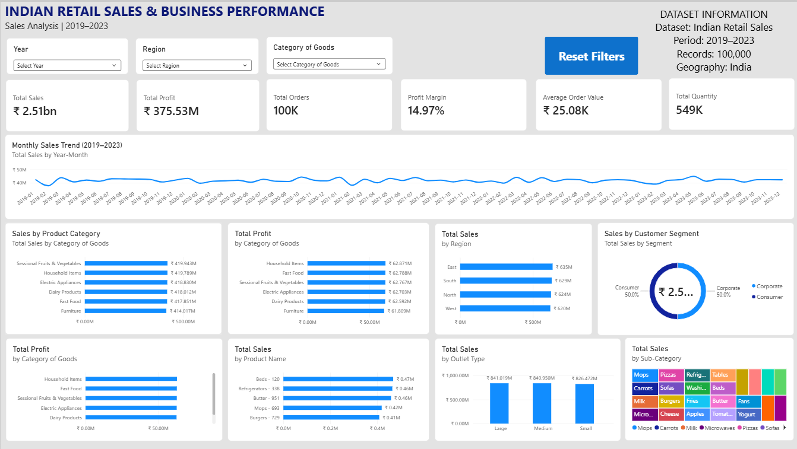

# Indian Retail Sales & Business Performance Dashboard (2019–2023)

## Project Overview

This project focuses on analyzing Indian retail sales data from 2019 to 2023 using Microsoft Power BI. The objective is to transform raw sales data into an interactive business intelligence dashboard that helps understand sales performance, profitability, customer segments, product categories, regional performance and outlet-level sales.

The dashboard provides an overview of key business metrics and allows users to explore performance through interactive filters.

## Project Objectives

- Analyze overall sales and profit performance.
- Understand sales trends over time.
- Identify top-performing product categories and sub-categories.
- Compare sales across different regions.
- Evaluate customer segment contributions.
- Analyze sales performance by outlet type.
- Build an interactive and user-friendly Power BI dashboard.

## Tools & Technologies

- **Microsoft Power BI Desktop** – Dashboard development and visualization.
- **Power Query** – Data cleaning and transformation.
- **DAX** – Calculated measures and date table creation.
- **CSV** – Source data format.

## Dataset Description

| Attribute | Details |
|---|---|
| Dataset | Indian Retail Sales |
| Time Period | 2019–2023 |
| Records | 100,000 |
| Columns | 25 |
| Geography | India |
| File Format | CSV |

The dataset contains information about customers, orders, products, sales, profit, discounts, shipping, regions and outlet types.

## Data Cleaning & Preparation

Data preparation was performed using Power Query.

Key steps included:

1. Imported the CSV dataset into Power BI.
2. Reviewed column quality, distribution and profiling.
3. Checked for missing values, errors and invalid records.
4. Corrected data types for date, numeric and categorical columns.
5. Converted Postal Code to Text.
6. Validated shipping dates against order dates.
7. Investigated inconsistencies between Sales Date, Order Date and the original Year column.
8. Removed the unreliable original Year column.
9. Retained the date columns and selected Order Date as the primary analytical date.
10. Renamed the final query to `Fact_Sales`.

**Date-quality consideration:** The original Year field did not consistently match the year extracted from the date columns. Sales Date and Order Date also differed for most records. Therefore, Order Date was selected as the reporting date for this dashboard. This is an analytical choice, not a verification of the original business definition of those fields.

## Data Modelling

A separate date table, `Dim_Date`, was created using DAX.

It includes:
- Date
- Year
- Month Number
- Month
- Quarter
- Year-Month

The date table was marked as a Date Table and connected to `Fact_Sales` through an active one-to-many relationship:

`Dim_Date[Date]` → `Fact_Sales[Order Date]`

## Key DAX Measures

The following measures were created:

- **Total Sales** – Sum of sales.
- **Total Profit** – Sum of profit.
- **Total Orders** – Distinct count of order IDs.
- **Profit Margin** – Total Profit divided by Total Sales.
- **Average Order Value** – Total Sales divided by Total Orders.
- **Total Quantity** – Sum of quantity sold.
- **Average Discount** – Average discount offered.

## Dashboard Preview

## Dashboard Features

The Sales Overview dashboard includes:

- KPI cards for major business metrics.
- Monthly Sales Trend (2019–2023).
- Sales by Product Category.
- Profit by Product Category.
- Sales by Region.
- Sales by Customer Segment.
- Top 10 Products by Sales.
- Sales by Outlet Type.
- Sales by Sub-Category using a Treemap.
- Interactive Year, Region and Category slicers.
- Reset Filters button using Power BI bookmarks.
- Dataset information panel.

## Key Business Metrics

The dashboard's initial unfiltered view displays approximately:

| Metric | Value |
|---|---:|
| Total Sales | 2.51bn |
| Total Profit | 375.53M |
| Total Orders | 100K |
| Profit Margin | 14.97% |
| Average Order Value | 25.08K |
| Total Quantity | 549K |

*These are displayed dashboard values. The currency and unit conventions should be confirmed against the dataset metadata before publication.*

## Business Questions Addressed

1. How do sales change over the 2019–2023 period?
2. Which product categories generate the highest sales?
3. Which categories contribute most to profitability?
4. Which regions generate the most revenue?
5. How do customer segments contribute to sales?
6. Which products are the top revenue contributors?
7. How do different outlet types perform?
8. How do sales vary across product sub-categories?

## Limitations

- The dataset is intended for practice and portfolio demonstration.
- Dataset provenance and real-world representativeness have not been independently verified.
- Date inconsistencies required an explicit analytical date selection.
- Business conclusions are limited to the fields and records available in the dataset.

## Conclusion

This project demonstrates an end-to-end Power BI analytics workflow, including data preparation, data modelling, DAX measure creation, interactive dashboard development and business performance analysis.

It showcases the ability to transform raw data into meaningful visual insights and present information through an interactive business intelligence report.

## Author

**Data Analytics Portfolio Project**

**Tools:** Power BI | Power Query | DAX

